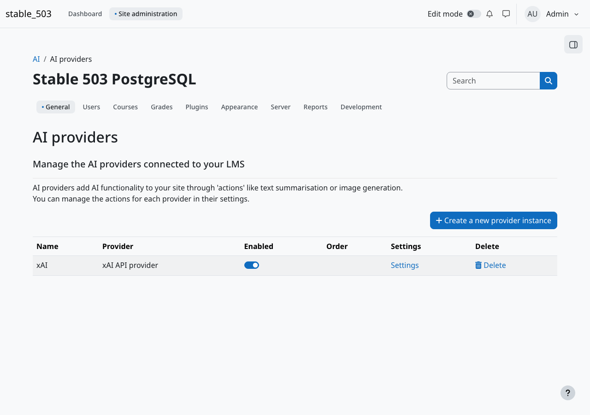
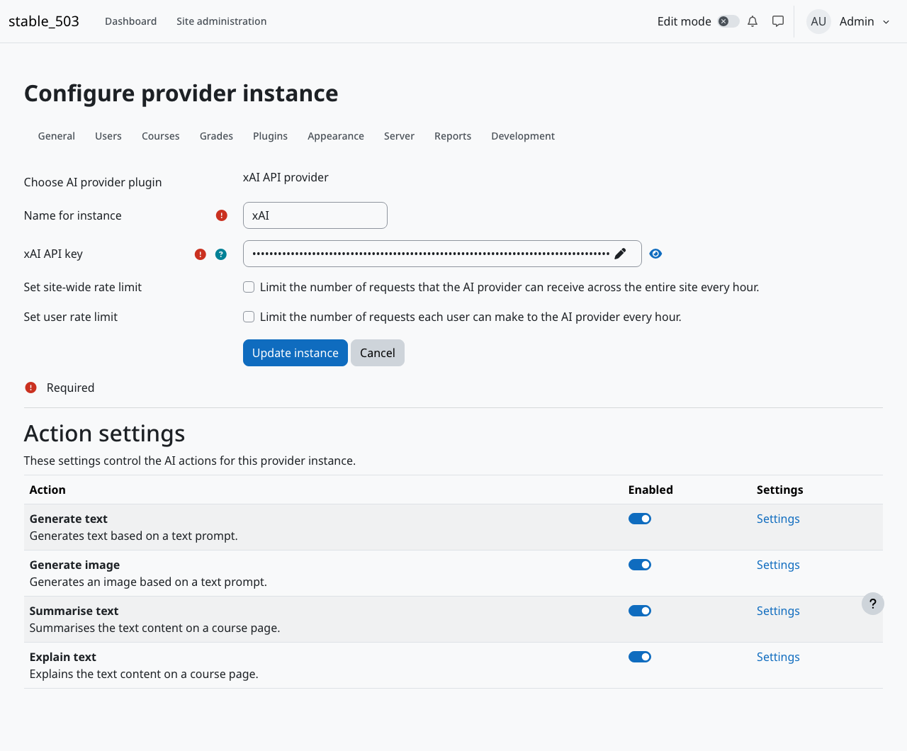
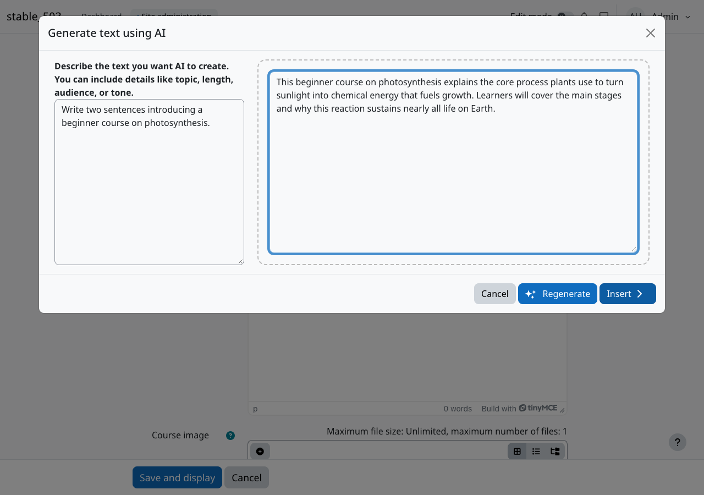

# xAI provider for Moodle

`aiprovider_xai` connects Moodle's AI subsystem to the [xAI API](https://x.ai) (Grok). It supports the core text and image actions used by Moodle placements.

This is an unofficial plugin. It is not affiliated with, endorsed by, or supported by xAI or by Moodle.

## Requirements

- Moodle 5.1, 5.2, or 5.3 (`$plugin->requires = 2025100600`, `$plugin->supported = [501, 503]`).
- PHP as required by that Moodle version.
- An xAI API key. xAI is a paid service: API use is billed to the account that owns the key.

## Installation

1. Download the plugin ZIP, or clone this repository.
2. Install it from Site administration → Plugins → Install plugins, or unzip it into `ai/provider/xai` (the folder must be named `xai`).
3. Open Site administration → Notifications to finish the install.

No extra plugins and no Composer step are required.

## API key

1. Sign in at the [xAI console](https://console.x.ai/).
2. Create an API key.
3. In Moodle, go to Site administration → General → AI → AI providers.
4. Create an instance of this provider and paste the key.

Keep the key secret. Requests send it as `Authorization: Bearer <key>`. Usage is charged by xAI according to your account.

## Screenshots

Moodle 5.3. The API key in the settings form is masked.

## Configuration

Each provider instance has one required setting, the API key.

Each supported action has its own settings: model, endpoint, and, for text actions, a system instruction. The text actions default to `grok-4.5`. Image generation defaults to `grok-imagine-image-2.0`. The model can be changed in the action settings: pick another preset or type a custom model id. Presets follow what the xAI API currently serves and can change; the custom field is there so a site is not stuck on a retired id.

Text actions can also set sampling options such as temperature, top p, and maximum completion tokens. Image generation can set resolution (`1k` or `2k` on the current default image model).

## Actions and placements

The plugin does not add its own buttons. Moodle placements call the core AI actions, and this provider handles them when it is enabled and ordered for that action.

| Action | What it does |
| --- | --- |
| Generate text | Chat completion from the user's prompt. |
| Summarise text | Same chat completion. The action supplies a short summary instruction. |
| Explain text | Same chat completion. The instruction asks for an explanation, not a summary. |
| Generate image | Image generation. Moodle stores one image, so the request asks for one image. Returned URLs expire, so the plugin requests base64. |

Typical placements are the text editor (generate text and generate image) and course assistance (summarise and explain). Enable the action on the provider, then enable it on the placement.

Chat history, vision input, and image editing are not supported.

Rate limits are Moodle's provider limits (per user and site-wide, per hour).

## Privacy

The plugin does not store personal data in its own tables. Prompts and related request fields are sent to xAI and are declared in the Privacy API as data in an external location.

xAI privacy policy: https://x.ai/legal/privacy-policy

That policy describes how xAI handles personal information. Data sent through the API is also subject to the terms of the xAI account that owns the key.

## Tracker

Bugs and feature requests: https://github.com/SergioComeron/moodle-aiprovider_xai/issues

## Releasing

`.github/workflows/release.yml` builds the plugin ZIP, publishes a GitHub Release, and submits that ZIP to the [Moodle plugins directory](https://marketplace.moodle.com/). Create the tag locally and push it. The workflow does not create tags.

Set the repository secret `MOODLE_MARKETPLACE_TOKEN` to a Moodle Marketplace API token. Create the token under Account settings → Security at <https://marketplace.moodle.com/account/security>, then add it in GitHub under Settings → Secrets and variables → Actions. The Marketplace step stops before the upload when that secret is missing, and the token is not written to the log.

1. In `version.php`, set `$plugin->release` to a three-part version such as `1.0.2`, and increase `$plugin->version` (`YYYYMMDDXX`) when the code changes. Leave `$plugin->maturity` as `MATURITY_STABLE` for a stable release.
2. Add a section to `CHANGES.md` whose heading is exactly `## v` plus that release, for example `## v1.0.2`, and describe the release under it.
3. Commit and push that change to `main`.
4. Tag that commit as `v` plus `$plugin->release`, then push the tag. Release `1.0.2` uses the tag `v1.0.2`.

Pushing the tag runs the workflow. It fails when the tag is not exactly `v` followed by `$plugin->release` inside the built ZIP. It builds `aiprovider_xai_<version>.zip`, where `<version>` is `$plugin->version`, with `git archive --prefix=xai/`. `.gitattributes` `export-ignore` drops `.git*`, `.github/`, `docs/`, `lang/es/`, `node_modules/`, `phpunit.xml`, and `*.dist` files. Tests and `lang/en` stay in the ZIP. The archive root is `xai/`, which Moodle installs into `ai/provider/xai`.

The ZIP is attached to the GitHub Release for that tag. Notes for a new GitHub Release come from the `CHANGES.md` or `CHANGELOG.md` section whose heading contains the tag or `$plugin->release`. When that section is missing, GitHub generates the notes from commits since the previous release. When the GitHub Release already exists, the workflow leaves its title and notes unchanged and replaces the ZIP asset.

The same ZIP is then posted to `https://marketplace.moodle.com/api/plugins/aiprovider_xai/versions`, with the GitHub repository URL, the tag, and release notes. Those notes are the body of the `CHANGES.md` section headed `##` plus the tag. When that section is missing, the notes are `Release` plus the tag. The directory must answer HTTP 201. Any validation errors in the response are printed and the workflow fails. The built ZIP is also stored as a workflow artifact.

To publish a tag that already exists, such as `v1.0.1`, open the Release workflow from the Actions tab, choose the branch that contains this workflow (normally `main`), and enter that tag. The ZIP is built from the tag. Marketplace release notes are read from `CHANGES.md` on the branch you selected. An existing GitHub Release is left in place and its ZIP asset is replaced.

## Credits

Parts of this plugin are adapted from Moodle core's OpenAI API provider, [`aiprovider_openai`](https://github.com/moodle/moodle/tree/MOODLE_503_STABLE/public/ai/provider/openai). The same files on `MOODLE_501_STABLE` and `MOODLE_502_STABLE` carry the same notices. Those notices are kept in the adapted files, next to the notice for this plugin.

- Matt Porritt `<matt.porritt@moodle.com>` (2024): the processor, provider, privacy provider, action forms, hook listener, English language strings, and the PHPUnit tests taken from that provider.
- Huong Nguyen `<huongnv13@gmail.com>` (2025 and 2026): the model chooser, model helper, model settings, and the shared testcase helper.
- David Woloszyn `<david.woloszyn@moodle.com>` (2024): the explain-text processor.

The community plugins [aiprovider_anthropic](https://github.com/LucaDR1998/moodle-aiprovider_anthropic) (Luca Demicheli Rubio; [Marketplace](https://marketplace.moodle.com/plugins/aiprovider_anthropic)) and [aiprovider_claude](https://github.com/ashishptl21/moodle-aiprovider_claude) (copyright in that repository: Treesha Infotech; [Marketplace](https://marketplace.moodle.com/plugins/aiprovider_claude), maintained by Ashish Patel and Raju Patel) were compared because they ship several of the same files. The copies here match `aiprovider_openai`. They do not include the Anthropic model-discovery code or the Claude messages API, so those plugins' own notices were not added.

Written for xAI, and left with only this plugin's notice: the Grok model presets, the Imagine image request mapping, system-instruction normalisation, preset migration, the upgrade step, and the tests for those parts.

`tests/fixtures/test.jpg` is the OpenAI provider's test image, unchanged. The JSON fixtures are that provider's fixtures with the model id, spacing, and an image MIME type adjusted. They are JSON, so they have no file docblock.

## Licence

GNU GPL v3 or later. See [LICENSE](LICENSE).
