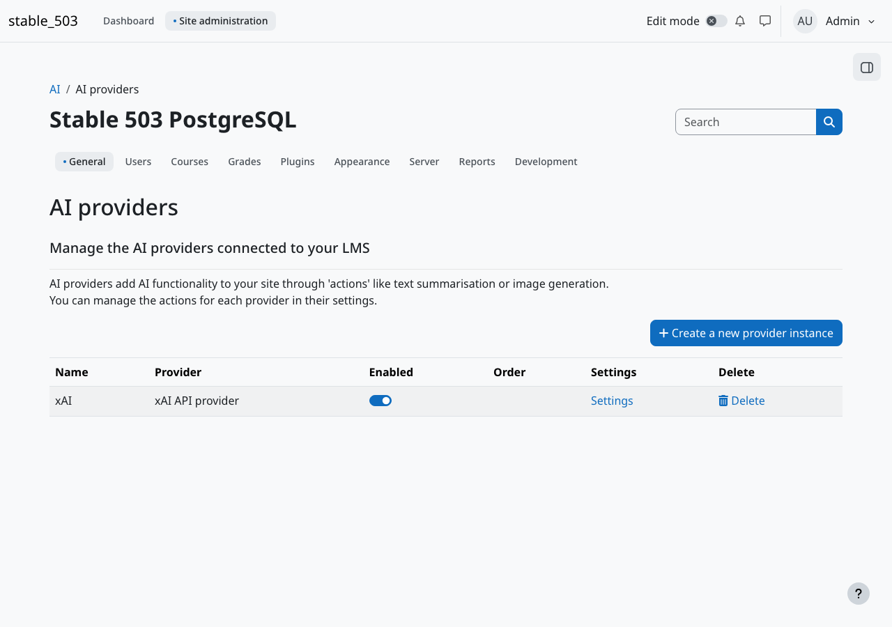
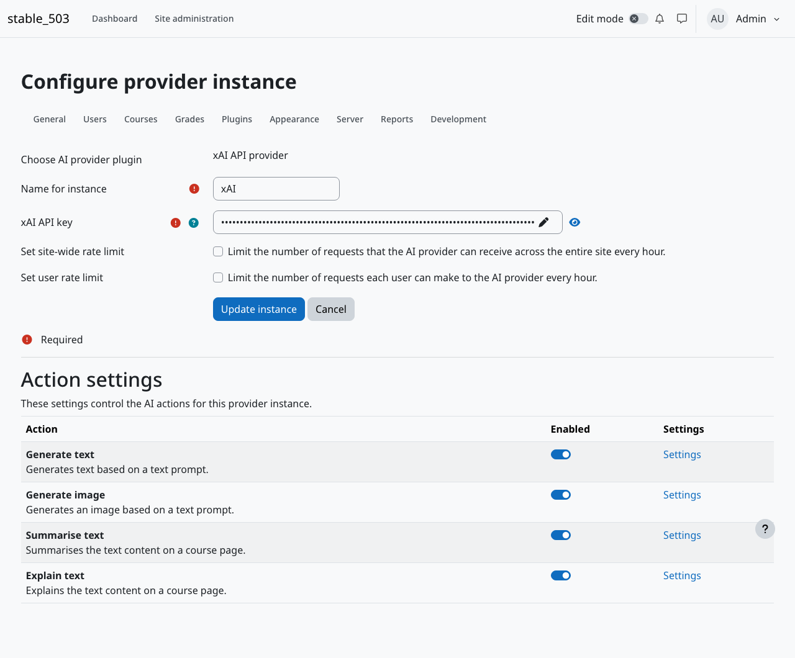
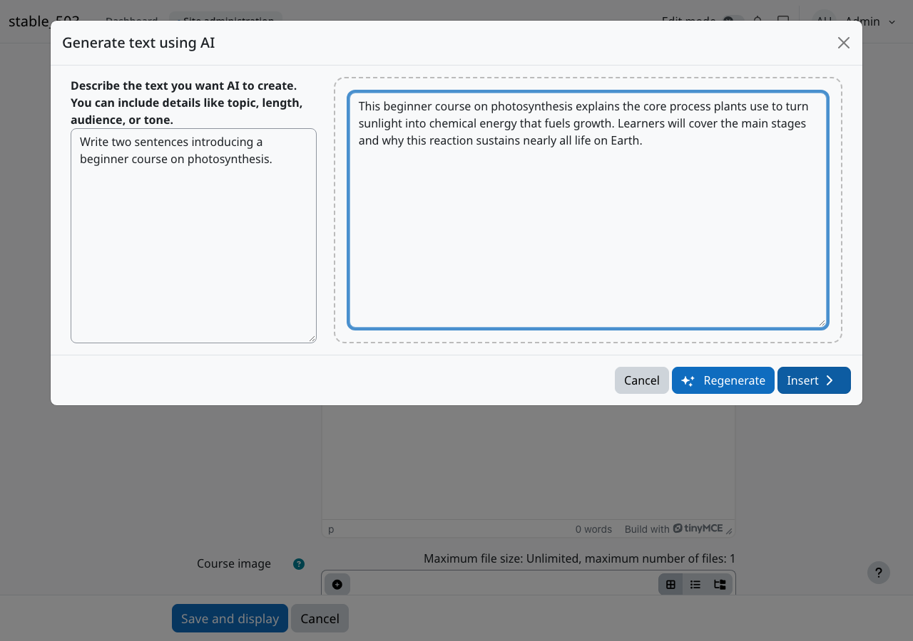

# Moodle Marketplace submission notes

These notes are for the plugin record. They are not installed as plugin language or settings.

## Short description

Unofficial Moodle AI provider that sends core text and image actions to the xAI API (Grok).

## Long description

aiprovider_xai connects Moodle 5.1, 5.2, and 5.3 to the xAI API. Placements such as the text editor and course assistance keep using Moodle's own actions. This provider handles generate text, summarise text, explain text, and generate image.

The plugin is unofficial. It is not affiliated with xAI or with Moodle. xAI is a paid service: each site needs its own API key from the xAI console, and API use is billed to that account.

The plugin does not store personal data. Prompts are sent to xAI. The xAI privacy policy is https://x.ai/legal/privacy-policy

Text actions default to grok-4.5 and image generation defaults to grok-imagine-image-2.0. An administrator can choose another preset or type a custom model id in the action settings.

Installation is a normal plugin ZIP. There are no extra plugin dependencies and no Composer step.

## URLs

- Documentation: https://github.com/SergioComeron/moodle-aiprovider_xai/blob/main/README.md
- Tracker: https://github.com/SergioComeron/moodle-aiprovider_xai/issues

## Screenshots

Captured on Moodle 5.3. The API key is masked. These files are in the git repository for the README and for this submission. `docs/` is marked `export-ignore`, so a plugin ZIP built with `git archive` does not install them.

Still useful to capture before upload, if you want them on the Marketplace record:

1. Generate text action settings, showing the model selector and system instruction.
2. Generate image action settings, showing the image model and resolution.
3. The text editor toolbar with the AI button visible, before the dialogue opens.
4. The editor generate-image dialogue showing one returned image.

Do not include a readable API key in any screenshot.

## Note for the reviewer

The plugin cannot call xAI without an API key, and xAI bills the account that owns the key. Please use a key you create at https://console.x.ai/ for the review. Do not expect a shared key in this repository or in this file. With no key, the provider reports that it is not configured and placements will not send requests.

Suggested checks without spending more than a few calls: create the provider, save the text action on the default model, run one generate-text prompt from the editor, and one generate-image prompt. Confirm the privacy registry lists the xAI external location and the privacy-policy URL.
